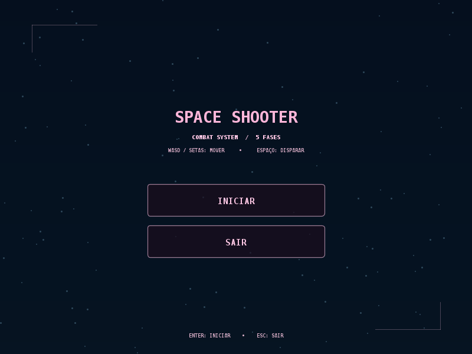
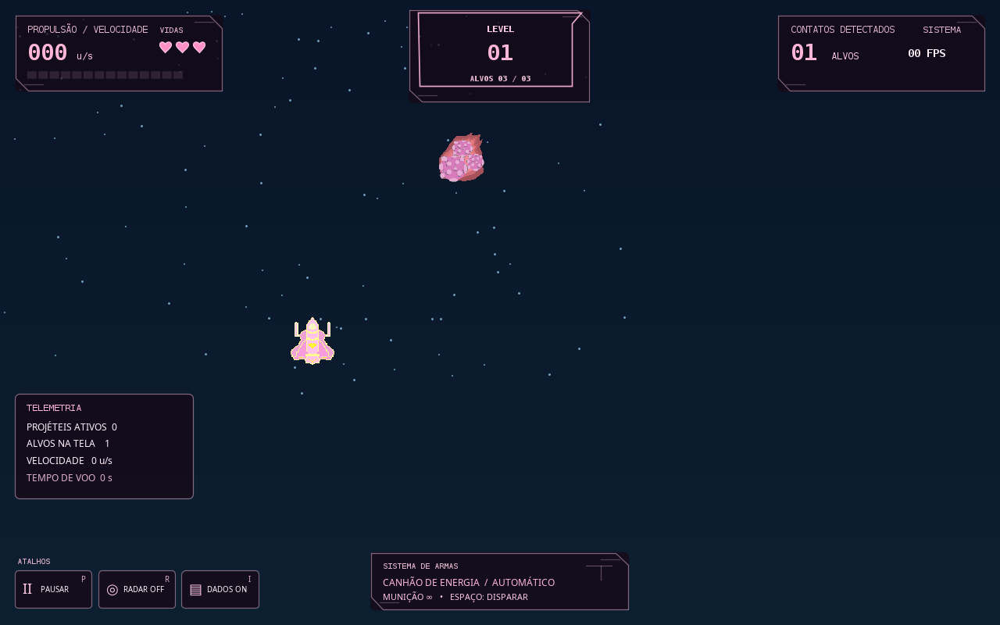
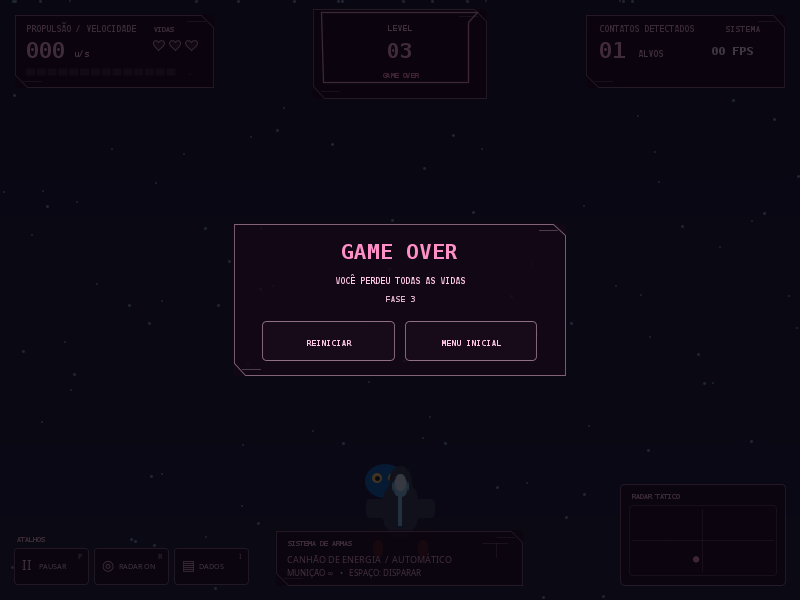

# Space Shooter — Menu, Combate e HUD

Jogo de tiro 2D para desktop desenvolvido individualmente em **Java**, utilizando Swing/AWT.

O projeto combina mecânicas de combate, progressão por fases, inimigos com diferentes características e uma interface HUD personalizada. Tanto a programação quanto os elementos visuais foram desenvolvidos por mim.

## Demonstração







## Funcionalidades

- **Menu interativo:** tela inicial com opções de iniciar e sair.
- **Sistema de combate:** movimentação da nave e disparos contra inimigos.
- **Inimigos variados:** três tipos de inimigos com velocidades diferentes.
- **Progressão por fases:** cinco fases com dificuldade crescente.
- **Sistema de vidas:** três vidas por partida, com invulnerabilidade temporária após colisões.
- **HUD personalizada:** interface temática em tons de rosa, com indicadores de vidas e informações da partida.
- **Radar tático:** visualização das posições dos elementos do jogo.
- **Pausa e reinício:** controles para pausar, retomar e iniciar novas partidas.
- **Telas de encerramento:** condições de vitória e Game Over.

## Tecnologias e ferramentas

- Java 17+
- Java Swing
- Java AWT
- IntelliJ IDEA
- Git e GitHub

## Controles

| Tecla | Ação |
|---|---|
| W, A, S, D ou setas | Movimentar a nave |
| Espaço | Disparar |
| P | Pausar ou retomar |
| R | Alternar radar |
| I | Alternar telemetria |
| Enter | Iniciar ou reiniciar |
| Esc | Retornar ao menu ou sair |
| Q | Sair pelo menu |

## Como executar

**Requisitos:** JDK 17 ou superior.

Clone o repositório e acesse a pasta do projeto.

Para compilar e executar:

```bash
javac Main.java
java Main
```

Também é possível executar a versão compilada:

```bash
java -jar space-shooter-hud.jar
```

## Estrutura do projeto

```text
Space_Shooter/
├── assets/
│   └── images/
│       ├── player.png
│       └── enemies/
│           ├── enemy_1.png
│           ├── enemy_2.png
│           └── enemy_3.png
├── Main.java
├── README.md
├── preview.png
├── combat-preview.png
├── game-over-preview.png
└── space-shooter-hud.jar
```

## Desenvolvimento

Este é um projeto individual, desenvolvido desde a programação das mecânicas até a criação dos elementos visuais.

Durante o desenvolvimento, foram trabalhados conceitos de:

- Programação orientada a objetos.
- Lógica de programação e estruturas de controle.
- Manipulação de eventos e entradas do teclado e mouse.
- Desenvolvimento de interfaces gráficas.
- Detecção de colisões e controle de estados.
- Organização de recursos e arquivos do projeto.
- Testes e correção de funcionalidades.

**Projeto desenvolvido como parte do meu aprendizado em desenvolvimento de jogos com Java.**
